# Mirage

**Um caderno de paisagens do mundo, desenhado à mão e animado.**

Dez paisagens a lápis, em tons de grafite sobre papel, atravessadas por um pequeno
viajante de mochila. Cada cena dura cerca de meio minuto: a paisagem se desenha, o
viajante entra, para no mirante para olhar e segue caminho. Depois da décima, o
caderno volta sozinho para a primeira.

**Ver ao vivo:** https://andreluis29.github.io/mirage/

Feito só com HTML, CSS e JavaScript puros: sem bibliotecas, sem etapa de build,
sem coleta de dados.

---

## Galeria

| | |
|---|---|
| 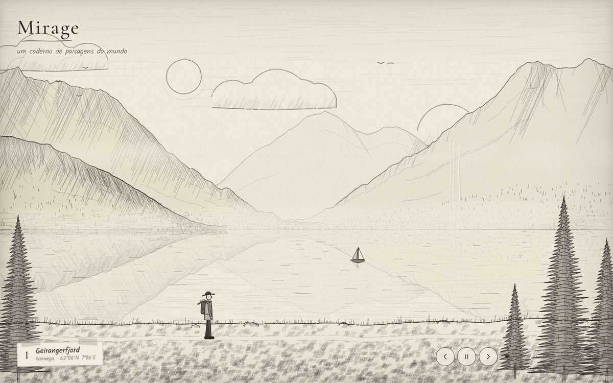 | 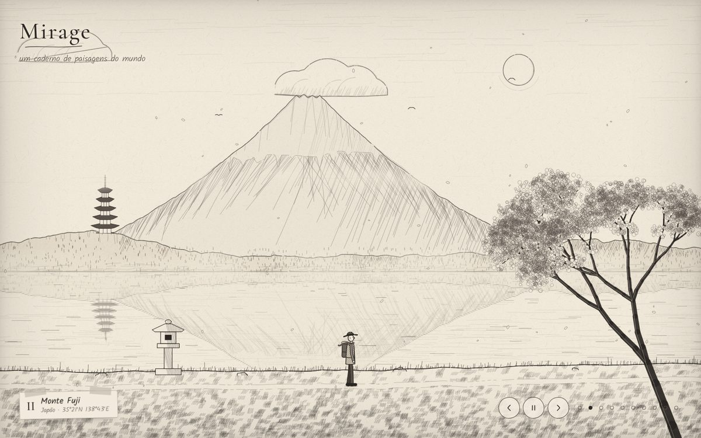 |
| **I · Geirangerfjord**, Noruega: calma, contemplativa. Cachoeiras, reflexo, névoa e barco à deriva. | **II · Monte Fuji**, Japão: delicada, serena. Cerejeira, pagode, lanterna e pétalas ao vento. |
| 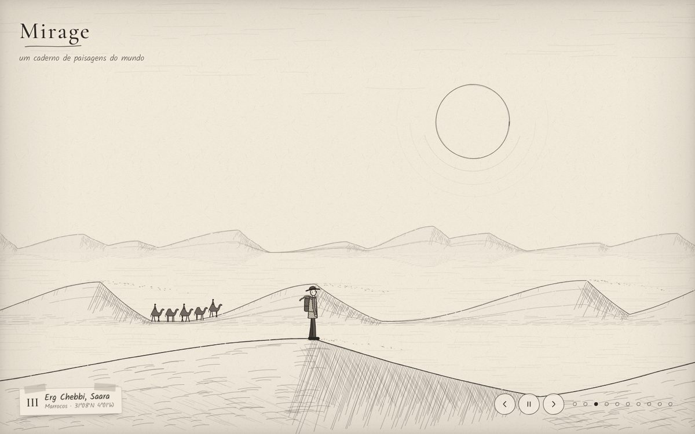 | 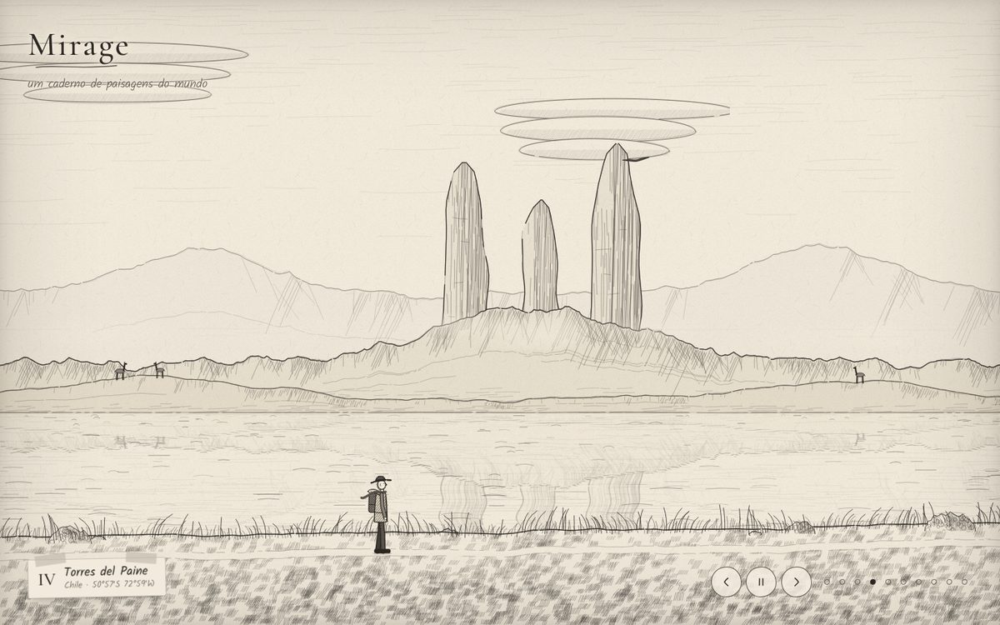 |
| **III · Erg Chebbi, Saara**, Marrocos: vasta, quente, silenciosa. Miragem no horizonte e caravana. | **IV · Torres del Paine**, Chile: selvagem, ventosa. Nuvens lenticulares, lago agitado e condor. |
| 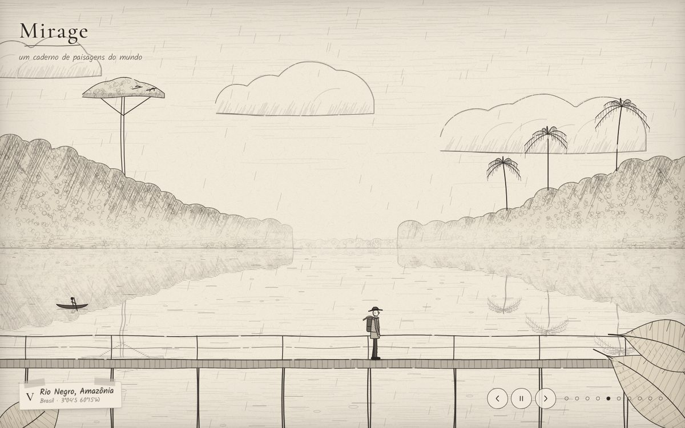 | 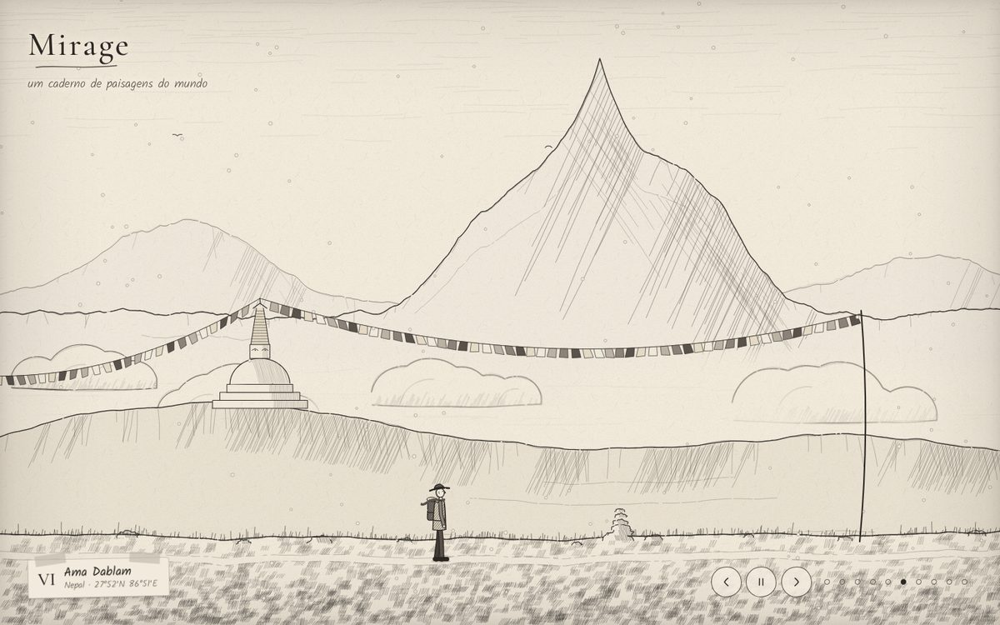 |
| **V · Rio Negro**, Amazônia: úmida, viva. Chuva, canoa, araras e trapiche. | **VI · Ama Dablam**, Nepal: rarefeita, espiritual. Mar de nuvens, estupa e bandeiras de oração. |
| 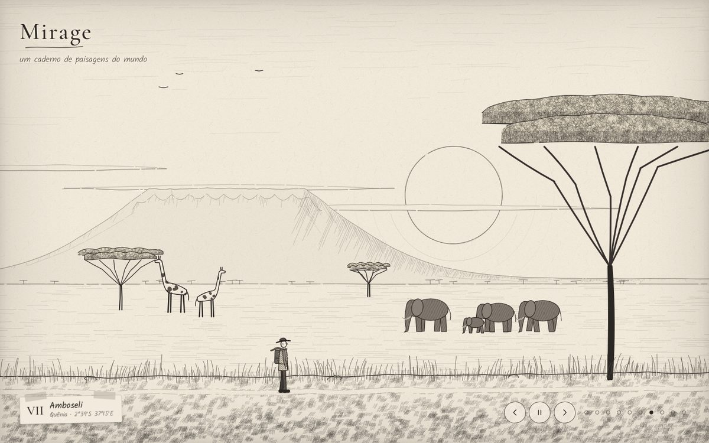 | 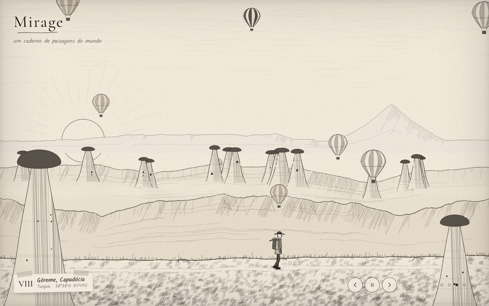 |
| **VII · Amboseli**, Quênia: quente, ampla. Kilimanjaro, acácias, girafas e elefantes. | **VIII · Göreme**, Turquia: onírica, leve. Chaminés de fada e balões subindo. |
| 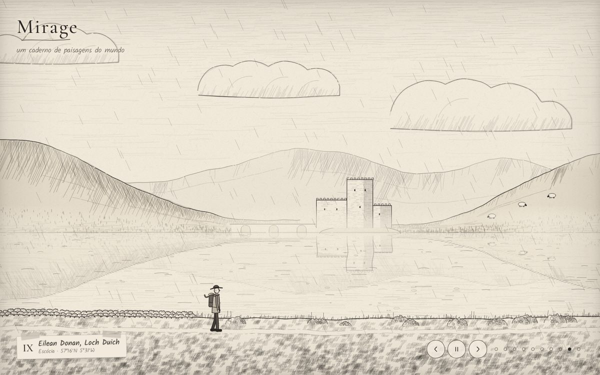 | 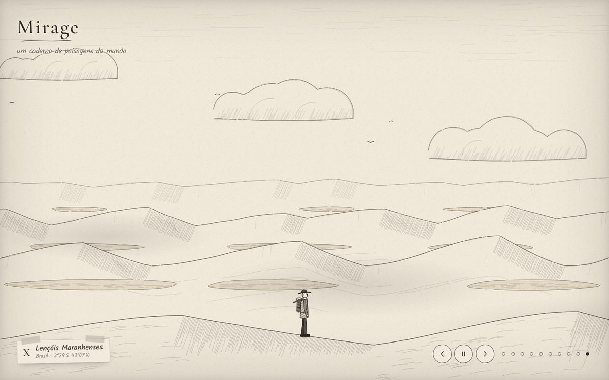 |
| **IX · Eilean Donan**, Escócia: melancólica, chuvosa. Castelo, ponte de arcos, ovelhas e urze. | **X · Lençóis Maranhenses**, Brasil: luminosa, aberta. Dunas brancas, lagoas e sombras de nuvem. |

No celular, o desenho se recompõe para a tela em pé:

| | | |
|---|---|---|
| 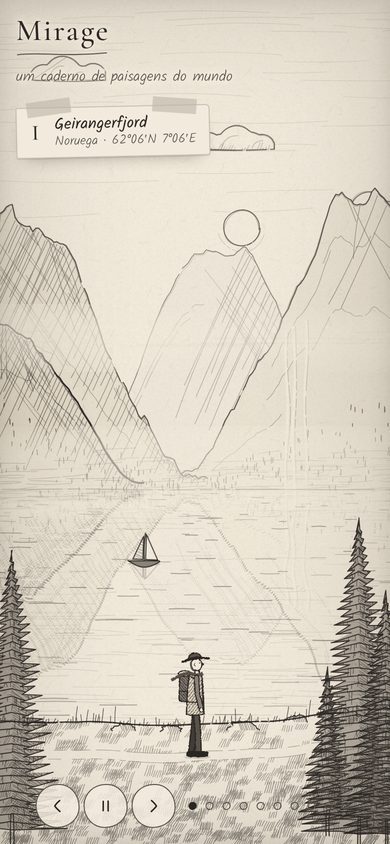 | 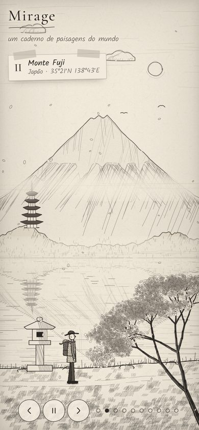 | 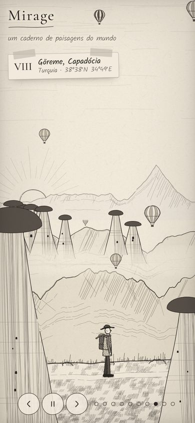 |

---

## Como usar

| Ação | Como |
|---|---|
| Próxima / anterior paisagem | botões `›` e `‹`, ou setas `→` e `←` do teclado |
| Pausar / continuar | botão do meio ou barra de espaço |
| Ir direto a uma paisagem | pontinhos ao lado dos botões |
| Link para uma paisagem | o endereço muda a cada cena: `…/mirage/#fuji`, `…/#saara`, `…/#lencois` |

Os nomes dos links são: `fiordes`, `fuji`, `saara`, `patagonia`, `amazonia`,
`himalaia`, `savana`, `capadocia`, `highlands` e `lencois`.

**Movimento reduzido.** Se o sistema estiver com "reduzir movimento" ligado, o
traço para de tremer, a troca de cena vira um esmaecer suave, o viajante fica parado
no mirante e o resto do mundo se move a 20% da velocidade.

---

## Como rodar no seu computador

Não há nada para instalar. Como o site usa só arquivos estáticos, basta servi-los
por HTTP:

```bash
git clone https://github.com/andreluis29/mirage.git
cd mirage
python3 -m http.server 8000
# abra http://localhost:8000
```

Qualquer servidor estático serve (`npx serve`, a extensão Live Server do VS Code
etc.). Abrir o `index.html` direto pelo explorador de arquivos também funciona na
maioria dos navegadores.

### Publicar no GitHub Pages

O repositório já está pronto: em **Settings → Pages**, escolha *Deploy from a branch*,
branch `main`, pasta `/ (root)`. O endereço fica `https://<usuário>.github.io/mirage/`.

---

## E a música?

**O Mirage não tem música, por escolha.** A sensação de cada cena vem do próprio
desenho: o ritmo do vento, a velocidade da água, da chuva e das nuvens, e quanto
papel fica em branco. Não há arquivo de áudio para trocar.

Se um dia você quiser uma trilha, o caminho mais simples e seguro é este:

1. Coloque o arquivo dentro do repositório, por exemplo `audio/trilha.mp3`.
   Use uma música que você tenha direito de publicar.
2. Em `index.html`, logo antes de `</main>`, acrescente:
   ```html
   <audio id="trilha" src="audio/trilha.mp3" loop preload="none"></audio>
   ```
3. Na política de segurança (a `<meta http-equiv="Content-Security-Policy">`),
   acrescente `media-src 'self';`. Sem isso, o navegador bloqueia o áudio.
4. Os navegadores só tocam som depois de um clique. Crie um botão de som nos
   controles e chame `document.getElementById('trilha').play()` no clique.

O passo a passo completo, inclusive como fazer o ritmo das cenas acompanhar a
música, está em [docs/COMO-FUNCIONA.md](docs/COMO-FUNCIONA.md#som).

---

## Estrutura

```
index.html          página, CSP, figura do viajante em SVG, controles
style.css           paleta, tipografia, etiqueta com fita, controles, celular
script.js           lápis, peças de desenho, as 10 cenas, viajante e motor
favicon.svg         ícone (montanha a lápis)
docs/COMO-FUNCIONA.md   arquitetura, cenas, som, personalização, extensão
docs/capturas/      imagens desta página
```

Arquitetura, como personalizar e como criar uma 11ª paisagem:
**[docs/COMO-FUNCIONA.md](docs/COMO-FUNCIONA.md)**.

---

## Segurança e privacidade

- A política de segurança (CSP em `<meta>`) só permite scripts e estilos do próprio
  site e as fontes do Google Fonts. Nada de conexões externas, formulários,
  plugins ou `<base>`.
- Nenhum `innerHTML`, `eval` ou `new Function`: todo o DOM é criado com
  `createElement` e `textContent`.
- Não há cookies, `localStorage`, analytics nem envio de dados. O endereço muda
  (`#fuji`) só para permitir o link direto; nada é guardado.
- O site não aceita upload de mídia.

## Créditos

Desenho, código e animação: **Mirage**, 2026.
Fontes: [Cormorant Garamond](https://fonts.google.com/specimen/Cormorant+Garamond)
e [Kalam](https://fonts.google.com/specimen/Kalam), ambas sob a SIL Open Font License.
